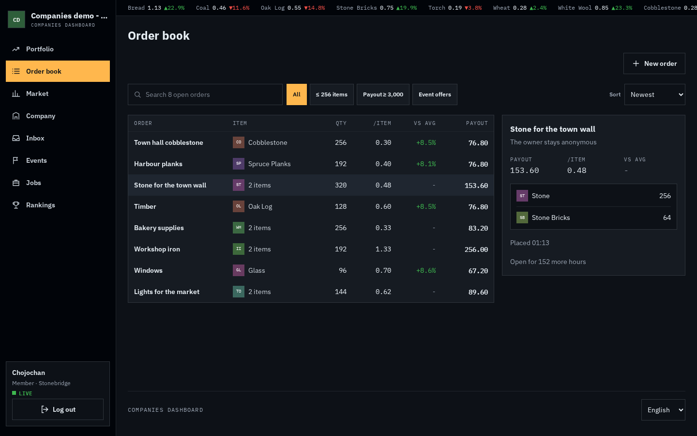
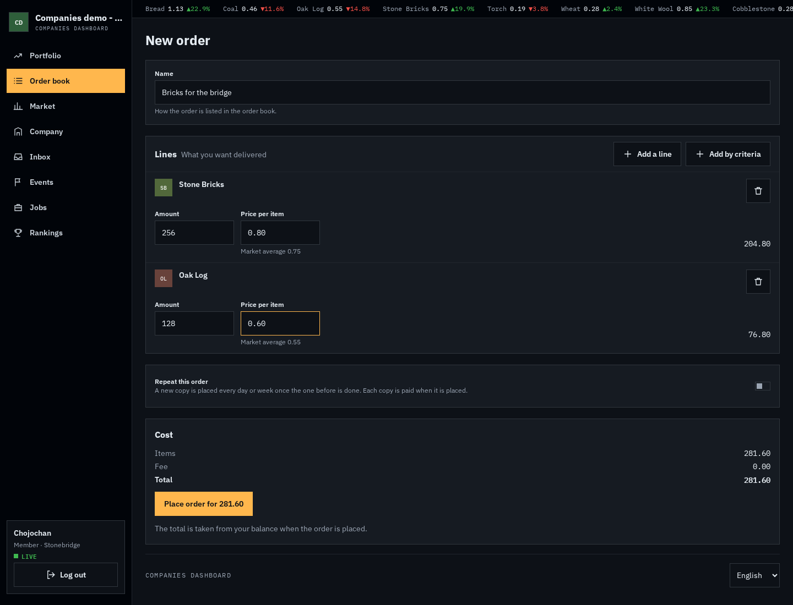
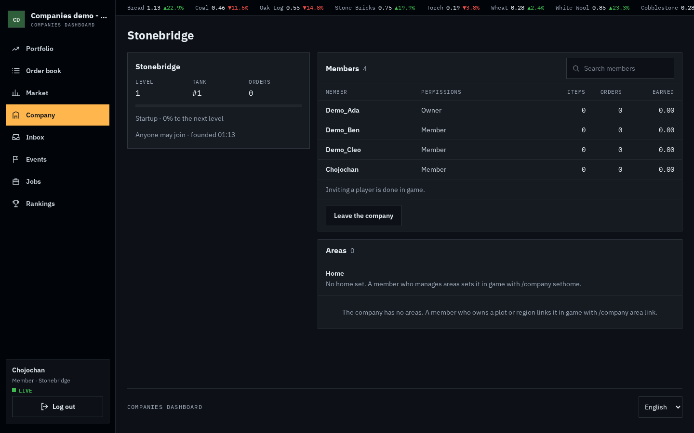
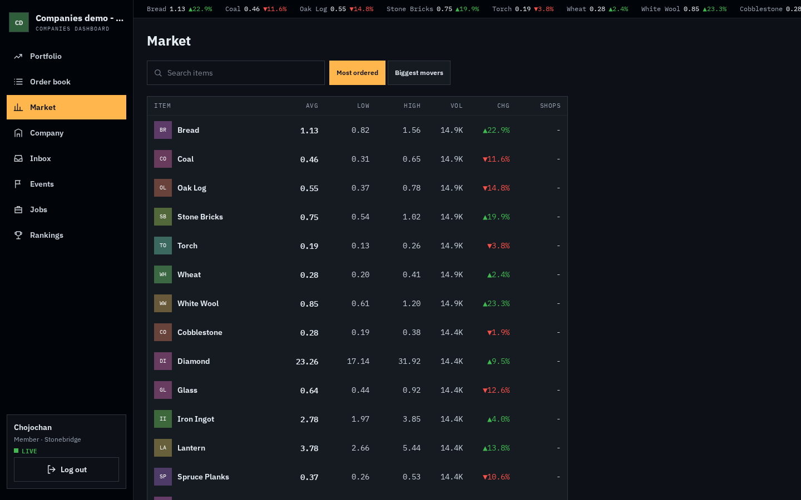
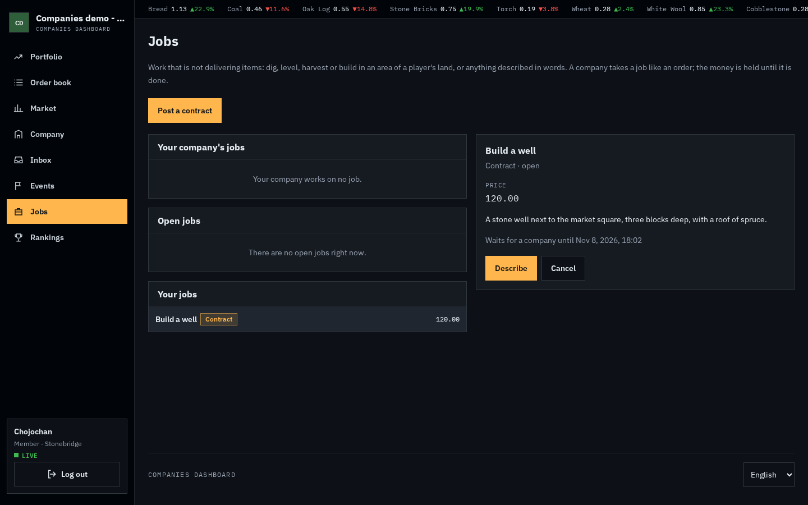

# Dashboard

The dashboard is where you do most things in Companies. Browse the order book, place and follow your own orders,
deliver for your company, run the company, read your inbox and watch market prices, all in a browser. Keep it open on
your phone next to the game: it updates while things happen on the server.

Every server with Companies has it. Every action there also has a command in game; the
[command reference](../reference/commands.md) lists them all. Only the market prices and their history are on the
dashboard alone. A few things happen only in game, because they need you in the world: inviting players by name, your
company's [home](../companies/home.md) and [areas](../companies/areas.md), posting jobs in an area,
[order boards](./order-boards.md), and delivering items to a contest.

## Opening it

1. Run `/company dashboard`.
2. A window shows a short link and a code, for example:

   ```text
   Open companies.eldoria.de/AB12CD on any device and enter the code.
   Login code: K P M W Q R, valid for 5 minutes
   ```

   Press **Open the dashboard**, or type the link into any browser, for example on your phone. On servers that show
   menus in chat, the link and the code appear in chat instead, and you click the link there. On Bedrock (through
   Geyser) the window is a form, and the button shows the link to type on your phone.
3. Enter the six letters of the code.

The chat says "The dashboard was opened on a browser" when you are logged in. If you see that message without having
logged in, run `/company dashboard logout` right away.

The code works for five minutes. After that, run `/company dashboard` again.

## Staying logged in

You stay logged in on that browser until you log out, or until you have not used the dashboard for a while (an hour by
default) or the server's maximum time has passed (a day by default). You can be logged in on several devices at once.

| Command | What it does |
|---|---|
| `/company dashboard` | Shows a new link and code. |
| `/company dashboard sessions` | Lists the browsers you are logged in on. |
| `/company dashboard logout` | Logs you out on every browser. |

## The views

The menu leads to these views:

| View | What it is for |
|---|---|
| **Portfolio** | Your start page: what your company is processing (positions), your own orders, your company's treasury and what happened in your company lately. |
| **Order book** | Every open order. Filter and search it, open an order, accept it for your company or place a new one. |
| **Market** | Prices of the delivered orders per item, and the items whose price moved most. |
| **Company** | Your company's members, applications, profile, treasury and areas. Without a company, you found one here. |
| **Inbox** | Notifications about your orders and your company, also the ones from while you were offline. |
| **Events** | Goals, contests and server events that run or start soon. |
| **Jobs** | Jobs your company holds, open jobs to take, and your own jobs, when the server uses jobs. |
| **Rankings** | Companies compared by orders, money earned, items delivered, members and level. |
| **Admin** | Only for admins: see [the admin tools](../admin/dashboard.md#admin-tools). |

### Order book



The order book lists every open order with what it asks for, what it pays per item against the market average, and the
payout. Search it, filter it (small orders, big payouts, player, server or event orders) and sort it by age, payout,
price per item, amount or name. Opening an order shows its lines and lets a member with the *manage orders* permission
accept it for the company. Accepted orders move to the **Positions** of your portfolio, where your company's members
deliver to them.

### Placing an order



**New order** in the order book or under *Your orders* opens the order builder:

1. Name the order.
2. Add lines. The item picker finds the server's materials, your [saved items](orders.md#saved-items) and the exact
   items of your earlier orders by typing.
3. For a material that can carry something, set what survival can give it: enchantments up to their highest
   survival level (never two that exclude each other), a potion type, a leather dye colour or an armour trim. Leave
   it empty to order the plain item.
   **Add by criteria** adds a [criteria line](orders.md#criteria-lines) instead: pick materials and item tags, and
   optionally a minimum number of enchantments and enchantments every item needs from a level on. While the set holds
   potions you can pick a potion type, and while it holds items with durability, how much of it has to be left. Any
   item of the set fills the line, mixed.
4. Give each line an amount and a price per item. Where the market knows the material, its average is filled in and
   shown beside the price.
5. Switch on *Repeat this order* for a [repeating order](repeating-orders.md): every day or week, for a number of
   copies or until a day.

While you build, the server says what the order costs: the items, the fee and the total, or why it would refuse the
order. **Place order** takes the total from your balance, even while you are not online, and opens your portfolio,
where the new order shows up.

Some servers run add-ons that can stop an order from being accepted, for example because of where you stand. Those
checks only run while you are online on that server. While you are not, the dashboard accepts without them.

### Company



The company page shows your company's members and their permissions, open applications, the profile, the treasury and
the [areas](../companies/areas.md) the company holds, with how it got each and until when a rent is paid, and its
[home](../companies/home.md). Areas and the home are changed in game. Without a company, you
[found one](../companies/founding-and-joining.md) here; the dashboard shows the price first.

### Market



The market page lists the average, lowest and highest price per item of the delivered orders, the most ordered items
first. **Biggest movers** shows the items whose average price changed in the last week against the week before, the
biggest change first. Opening an item shows its average price per day over a week, a month or three months.

The price history and its changes come from orders companies delivered; orders worked on alone and lines that ask for
an exact item are not part of them. An item whose delivered orders were removed from the server's history still shows
what its price history adds up to.

An item or a day with fewer delivered orders than the server's minimum shows no price, and such days do not count
towards a change, so no single order can be traced back to the player who placed it.

Where the server reads prices from its shop plugins, the **Shops** column shows the [shop
price](../admin/configuration/prices-yml.md) of an item, and opening the item says what it came from. Items only the
shops price are listed after the ordered ones. While an item has too few delivered orders, order prices go by its shop
price; the shop price is then shown in bold.

### Jobs



The **Jobs** page lists the jobs your company holds, the open [jobs](jobs.md) companies may take, and your own jobs.
Open one to see its price, place, time and what happened to it, and to take the steps you may take, as the commands
allow them. You can post a **contract** here: a title, a description, a price and the hours
a company gets to finish it. Jobs in an area (dig, terraform, harvest, build) need a selection in the world and are
posted in game; dig, terraform and build jobs are also finished in game, where their area is checked. The owner of a job
is never named to companies, and the company working on your job is never named to you.

### Events

The **Events** page lists the [event offers](event-offers.md), the goals and contests that run, are paused or start
within a day: what each asks for, a progress bar, the time until it starts
or ends, and for a contest your company's place. Above them, the [server events](server-events.md) that run or start
within a day show their effect, the items and company levels they apply to, the time left and, for a reward
multiplier with a budget, what it can still pay; an offer that belongs to a server event names it. The running server
events and offers also lead the ticker at the top; a click opens the Events page or the offer's page.

- A **goal** shows its chunk size and the companies that delivered most; players working alone are not named.
  **Show its orders** opens the order book with only that goal's chunks.
- A **contest** shows its prizes, the ranking of the companies that delivered, and your company's part: whether it
  takes part, what it delivered, what its workers were paid and its place. Members with the *manage orders*
  permission join or leave the contest for the company there. Delivering stays in game with
  `/company contest deliver <id>`, as it takes the items from your inventory.

In the order book, chunks of goals carry an **Event** badge, and the order's details name the goal with a link to its
page. The **Event offers** filter shows only chunks, and **Offer ends** sorts them by the end of their goal, as the
in-game search does.

## What you see

You see what you see in game, nothing more. Your own orders show their progress, but not which company or worker
delivers them. Your company's orders show their progress, but not who placed them. Inside your company, you see which
member delivered what.

## What you can do

Everything is checked by the server as if you typed the command, so the dashboard allows exactly what you may do in
game. When the server refuses, the dashboard shows its reason. Each action has its command in game; see the
[command reference](../reference/commands.md).

| Where | Action |
|---|---|
| Order book | Accept an order for your company (needs the *manage orders* permission) |
| Positions | Deliver to an order your company works on: everything you carry for it, or one line (only while you are online) |
| Positions | Give an order your company works on back to the order book (needs the *manage orders* permission) |
| Order book, Your orders | Place a new order, see [Placing an order](#placing-an-order) |
| Your orders | Give an open order more time |
| Your orders | Raise what an open order pays; the dashboard shows the fee and the total before you pay |
| Your orders | Cancel an open order; it asks again first and tells you when a repeating order stops with it |
| Your orders | Receive a delivered order into your inventory; what does not fit waits to be collected (only while you are online) |
| Your orders | Collect the items waiting for you (only while you are online) |
| Inbox | Mark everything read, delete the read entries, mute or unmute a category |
| Company | Change a member's permissions, only those you hold yourself (needs *manage permissions*) |
| Company | Remove a member (needs *kick*; nobody removes the owner) |
| Company | Leave the company; the owner hands it over first |
| Company | Hand the company to a member; you stay a member without owner rights (owner only) |
| Company | Dissolve the company after typing its name: its orders go back to the order book, delivered items to the members who delivered them, the treasury is paid out to you (owner only) |
| Company | Found a company when you have none; the dashboard shows the price first and takes it from your balance, also while you are not online |
| Company | Accept or deny an application, take back an invite (needs *invite*) |
| Company | Edit description, tag and colour, change how players join (needs *edit profile*) |
| Company | Rename the company, paid by you or from the treasury; the dashboard shows the price first (owner only) |
| Company | Pay into the treasury; take money out and set the share of payouts it keeps (needs *treasury*) |
| Events | Let your company join a contest or leave it (needs *manage orders*) |
| Jobs | Post a contract; its price and the fee are taken at once |
| Jobs | Describe or cancel your waiting job, approve, reject or dispute work, withdraw your dispute, end your harvest |
| Jobs | Take a job for your company, give it back, say a contract is done, end a harvest, dispute or withdraw (needs *manage orders*) |
| Jobs | Give a job a company works on [more time](./jobs.md#more-time), grant or refuse the company's request |
| Jobs | Ask the owner of your company's job for more time (needs *manage orders*) |

A server owner can switch single parts of the dashboard off; their buttons then do not appear.

## Moving items

Delivering, receiving and collecting take items out of your inventory or put them in, so they work only while you are
online on the server, on whichever of its servers you are. While you are not, positions and delivered orders say so
instead of showing their buttons, and the button to collect waiting items is hidden. Delivering picks the items exactly
as the command does.
